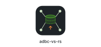

<div align="center">



[](https://www.rust-lang.org/)
[](https://github.com/exasol-labs/adbc-vs-rs/actions/workflows/ci.yml)
[](specs/)
[](https://www.exasol.com)
[](./LICENSE)

**An Exasol Virtual Schema that queries ADBC-based databases and query engines, and moves the data as Apache Arrow record batches. Written in Rust 🦀**

</div>

---

## What this is

> [!NOTE]
> [Exasol](https://www.exasol.com) is a high-performance analytics database built for agents, speed, and scalability. You can try it with [Exasol Personal](https://github.com/exasol/exasol-personal), the [SaaS free trial](https://cloud.exasol.com), or a local [Docker image](https://hub.docker.com/r/exasol/docker-db).

`adbc-vs-rs` is an Exasol [Virtual Schema](https://docs.exasol.com/db/latest/database_concepts/virtual_schemas.htm). It shows the tables and views of a MySQL, PostgreSQL, or Trino database as virtual tables in Exasol. You query the source with Exasol SQL and copy no data first.

`adbc-vs-rs` connects to the source through an [ADBC](https://arrow.apache.org/adbc/) driver and returns Arrow record batches without a row-by-row step.

The adapter installs the ADBC driver itself. It downloads ADBC drivers from the [ADBC Driver Registry](https://dbc-cdn.columnar.tech), the same one used by [dbc](https://github.com/columnar-tech/dbc). [Columnar](https://github.com/columnar-tech) runs the registry. The drivers themselves are developed by the [ADBC Driver Foundry](https://adbc-drivers.org) and the [Apache Arrow ADBC](https://github.com/apache/arrow-adbc) project. The adapter writes the driver to [BucketFS](https://docs.exasol.com/db/latest/administration/on-premise/bucketfs/bucketfs.htm). On a cluster without internet access, you upload the driver to BucketFS yourself.

- **SQL pushdown.** Column selection, filters, aggregation, and equi and outer joins run at the source.
- **Read-only.** `adbc-vs-rs` does not write to the source.

---

## Quick start

Install the shared library and create the scripts once. See [Install & Set Up](docs/install.md). Then create a virtual schema for a MySQL database and query it like any other Exasol schema.

> [!NOTE]
> This example uses MySQL. PostgreSQL and Trino work the same way. See [Create a Virtual Schema](docs/create-virtual-schema.md).

```sql
CREATE OR REPLACE CONNECTION MYSQL_CONNECTION
  TO 'mysql://mysql.example.com:3306/shop'
  USER 'adbc_vs' IDENTIFIED BY '<password>';

CREATE VIRTUAL SCHEMA MYSQLVS USING ADBC_VS.ADBC_ADAPTER WITH
  DRIVER = 'mysql'
  CONNECTION_NAME = 'MYSQL_CONNECTION';

SELECT * FROM MYSQLVS."customers";
```

---

## Documentation

See [**docs/**](docs/index.md):

- [Install & Set Up](docs/install.md) - Requirements, scripts, drivers
- [Air-gapped environments](docs/install.md#install-the-driver-yourself) - Deployments without internet access
- [Create a Virtual Schema](docs/create-virtual-schema.md) - Connections, properties, and specifics for each database
- [How Does It Work](docs/how-it-works.md) - The adapter and the scan UDF, and the [limits](docs/how-it-works.md#limits)

---

## Supported databases

- [x] MySQL
- [x] PostgreSQL
- [x] Trino
- [ ] Snowflake
- [ ] Databricks
- [ ] DuckDB

## License

Community-supported. Licensed under [MIT](LICENSE).

---

<div align="center">

Built with Rust 🦀 and made with ❤️. Maintained by [Exasol Labs 🧪](https://github.com/exasol-labs/).

</div>
